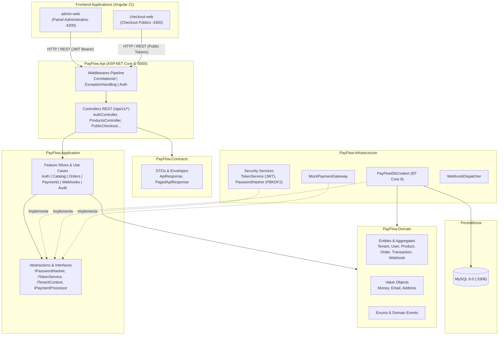
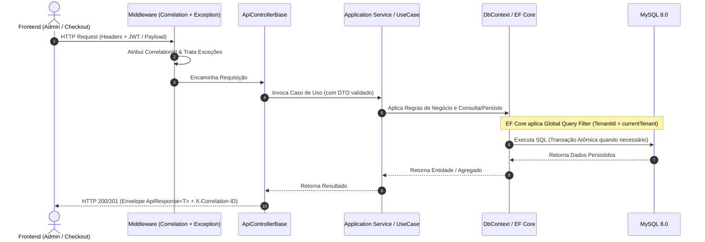
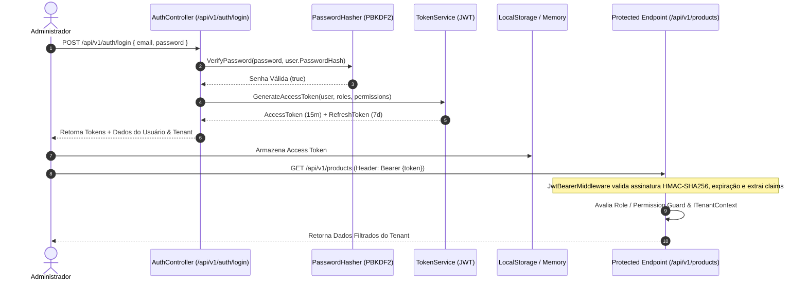

# PayFlow Checkout — Plataforma SaaS de Checkout & Pagamentos

[](https://dotnet.microsoft.com/)
[](https://angular.dev/)
[](https://www.mysql.com/)
[](https://tailwindcss.com/)
[](https://www.docker.com/)
[](#17-testes)
[](#5-arquitetura-do-sistema)

> Plataforma SaaS multi-tenant desenvolvida para orquestração de checkout white-label e pagamentos digitais simulados (PIX, Cartão de Crédito e Boleto Bancário). O ecossistema combina um backend robusto em **ASP.NET Core 8 (.NET 8 LTS)** com **Clean Architecture**, persistência em **MySQL 8** via **Entity Framework Core**, e duas aplicações frontend modernas em **Angular 21** com **Standalone Components**, **Signals** e **Tailwind CSS 4**.

---

## Sumário

- [1. Nome do Projeto &amp; Apresentação](#1-nome-do-projeto--apresentação)
- [2. Visão Geral](#2-visão-geral)
- [3. Principais Funcionalidades](#3-principais-funcionalidades)
- [4. Tecnologias Utilizadas](#4-tecnologias-utilizadas)
- [5. Arquitetura do Sistema](#5-arquitetura-do-sistema)
  - [5.1 Visão Geral das Camadas (Clean Architecture)](#51-visão-geral-das-camadas-clean-architecture)
  - [5.2 Bounded Contexts / Módulos](#52-bounded-contexts--módulos)
  - [5.3 Fluxo Completo de Requisição](#53-fluxo-completo-de-requisição)
  - [5.4 Fluxo de Autenticação e Autorização](#54-fluxo-de-autenticação-e-autorização)
  - [5.5 Isolamento Multi-tenant](#55-isolamento-multi-tenant)
- [6. Estrutura de Diretórios](#6-estrutura-de-diretórios)
- [7. Pré-requisitos](#7-pré-requisitos)
- [8. Verificando o Ambiente](#8-verificando-o-ambiente)
- [9. Instalação Passo a Passo](#9-instalação-passo-a-passo)
- [10. Variáveis de Ambiente](#10-variáveis-de-ambiente)
- [11. Banco de Dados &amp; Migrations](#11-banco-de-dados--migrations)
- [12. Executando o Projeto Localmente](#12-executando-o-projeto-localmente)
- [13. Executando com Docker Compose](#13-executando-com-docker-compose)
- [14. URLs Locais &amp; Portas](#14-urls-locais--portas)
- [15. Autenticação, Autorização &amp; RBAC](#15-autenticação-autorização--rbac)
- [16. API &amp; Endpoints](#16-api--endpoints)
- [17. Testes](#17-testes)
- [18. Qualidade de Código &amp; Linters](#18-qualidade-de-código--linters)
- [19. Build de Produção](#19-build-de-produção)
- [20. Fluxo de Desenvolvimento Recomendado](#20-fluxo-de-desenvolvimento-recomendado)
- [21. Padrões Arquiteturais &amp; Boas Práticas](#21-padrões-arquiteturais--boas-práticas)
- [22. Segurança](#22-segurança)
- [23. Troubleshooting (Problemas Comuns)](#23-troubleshooting-problemas-comuns)
- [24. Como Contribuir](#24-como-contribuir)
- [25. Status do Projeto](#25-status-do-projeto)
- [26. Roadmap](#26-roadmap)

---

## 1. Nome do Projeto & Apresentação

- **Nome:** PayFlow Checkout
- **Propósito:** Plataforma SaaS de checkout white-label de alta conversão e orquestração de pagamentos digitais com ambiente sandbox mock.
- **Estágio Atual:** **MVP Completo e Operacional** — Backend modular em .NET 8 com 16 controllers e 21 testes unitários aprovados, banco MySQL 8 com migrations e seeder automático, painel administrativo (`admin-web`) e checkout público (`checkout-web`) em Angular 21 integráveis via Docker ou execução bare-metal.

---

## 2. Visão Geral

Pequenos negócios, infoprodutores e empresas SaaS necessitam comercializar produtos digitais ou serviços através de links diretos e checkouts customizados sem a complexidade de manter contratos diretos com dezenas de adquirentes ou lidar com compliance PCI-DSS nível 1 antes de validar o modelo de negócio.

O **PayFlow Checkout** resolve esse problema fornecendo:

1. Um **Painel Administrativo SaaS** para o lojista cadastrar produtos, gerenciar clientes, monitorar transações financeiras, criar links de pagamento e customizar a identidade visual do seu checkout.
2. Um **Checkout Público White-label** leve, responsivo e focado em alta conversão, suportando PIX dinâmico (com QR Code e Copia-e-Cola), Cartão de Crédito com cálculo de parcelas e Boleto Bancário.
3. Um **Mecanismo de Sandbox Simulado** que desacopla o processamento de pagamentos através de abstrações de gateway (`IPaymentProcessor`), permitindo testes de ponta a ponta sem tráfego de dados sensíveis de cartão real (sem retenção de PAN/CVV).

### Público-alvo

- **Lojistas / Administradores (Owners & Admins):** Gestão comercial, branding do checkout e visualização de métricas financeiras.
- **Operadores / Analistas:** Consulta operacional de pedidos, clientes e emissão controlada de reembolsos simulados.
- **Consumidores Finais:** Experiência de compra fluida em checkout público seguro e responsivo.
- **Desenvolvedores Integradores:** Integração de eventos assíncronos via endpoints de Webhooks com retry automático e assinatura criptográfica.

---

## 3. Principais Funcionalidades

- **Autenticação & Controle de Acesso (RBAC):** Autenticação stateless via JWT Bearer tokens (HMAC-SHA256) com refresh token rotativo, multi-tenancy e perfis granulares (`Owner`, `Admin`, `Analyst`, `SupportReadOnly`).
- **Dashboard Financeiro Executivo:** Indicadores operacionais (Receita do dia, Taxa de Aprovação, Volume Transacionado, Ticket Médio), gráficos analíticos de desempenho e extrato de transações recentes.
- **Catálogo de Produtos:** Cadastro e gerenciamento de produtos físicos, digitais e serviços com precificação monetária precisa em `decimal`, SKU e controle de status.
- **Gestão de Clientes:** Base centralizada de compradores vinculada aos pedidos e transações do tenant.
- **Links de Pagamento Personalizados:** Geração de URLs públicas seguras indexadas por token alfanumérico (`plk_*`), com definição de desconto para PIX, quantidade máxima de parcelas e expiração.
- **Checkout White-label Público:**
  - Identidade visual customizável por merchant (cores, tipografia, bordas e mensagens de confirmação).
  - **PIX:** Simulação de QR Code dinâmico, código Copia-e-Cola e contador de expiração.
  - **Cartão de Crédito:** Validação de formato, seleção de bandeira, cálculo de parcelas e checkout sem exposição de dados sensíveis.
  - **Boleto Bancário:** Geração de linha digitável e simulação de compensação.
  - Tela de sucesso com status em tempo real e redirecionamento configurável.
- **Gestão de Pedidos & Transações:** Histórico de status (`Pending`, `Paid`, `Failed`, `Refunded`), conciliação operacional e estorno/reembolso simulado com registro de auditoria.
- **Webhooks com Retry:** Configuração de endpoints de webhook por tenant, disparo assíncrono de eventos de pagamento e histórico de entregas (`WebhookDeliveries`).
- **Trilha de Auditoria (Audit Log):** Registro detalhado e imutável de mutações de dados críticos, contendo `UserId`, `TenantId`, IP de origem, `CorrelationId` e delta de modificação.
- **Documentação Interativa de API:** Especificação OpenAPI 3.0 via Swagger UI e arquivo executável `PayFlow.Api.http`.

---

## 4. Tecnologias Utilizadas

### Backend

- **Linguagem & Framework:** C# 12 / ASP.NET Core 8.0 (.NET 8 LTS)
- **Acesso a Dados:** Entity Framework Core 8.0.2 com provider `Pomelo.EntityFrameworkCore.MySql` (v8.0.2)
- **Segurança & Criptografia:** JWT Bearer Authentication (`Microsoft.AspNetCore.Authentication.JwtBearer` 8.0.2), PBKDF2 com HMAC-SHA256 (`System.Security.Cryptography`) e comparação em tempo constante (`FixedTimeEquals`)
- **Documentação de API:** Swashbuckle / OpenAPI (`Swashbuckle.AspNetCore` 6.6.2)
- **Testes Automatizados:** xUnit 2.5.3, `Microsoft.NET.Test.Sdk` 17.8.0, `Microsoft.EntityFrameworkCore.InMemory` 8.0.11, `coverlet.collector` 6.0.0

### Frontend (Admin & Checkout)

- **Framework:** Angular 21 (`@angular/core` 21.2.0, `@angular/cli` 21.2.23, `@angular/cdk` 22.1.5)
- **Arquitetura de Componentes:** Standalone Components, Angular Signals, Control Flow nativo (`@if`, `@for`), Reactive Forms
- **Estilização:** Tailwind CSS 4 (`@tailwindcss/postcss` 4.1.12, `tailwindcss` 4.1.12)
- **Ícones:** Lucide Angular (`@lucide/angular` 1.40.0)
- **Testes Unitários:** Vitest 4.1.11 com JSDOM 28.0.0

### Banco de Dados

- **SGBD:** MySQL 8.0
- **Estratégia Multi-tenant:** Banco compartilhado com isolamento por `TenantId` em todas as tabelas de negócio e aplicação transparente de **EF Core Global Query Filters**.

### Infraestrutura & DevOps

- **Containerização:** Docker & Docker Compose
- **Build de Container:** Multi-stage build otimizado em `infra/docker/Dockerfile.api`
- **Configuração Padronizada:** EditorConfig (`.editorconfig`) e Git Attributes (`.gitattributes`)

---

## 5. Arquitetura do Sistema

O backend foi construído sob os preceitos de **Clean Architecture** e **Monólito Modular** com separação vertical de casos de uso (*Feature Slicing*), garantindo que as regras de negócio permaneçam puras, isoladas de detalhes de infraestrutura e altamente testáveis.



### 5.1 Visão Geral das Camadas (Clean Architecture)

| Camada                   | Projeto                    | Responsabilidade                                                                                                                                                                                                                                 |
| ------------------------ | -------------------------- | ------------------------------------------------------------------------------------------------------------------------------------------------------------------------------------------------------------------------------------------------ |
| **Presentation**   | `PayFlow.Api`            | Ponto de entrada HTTP, injeção de dependências, pipeline de middlewares (`CorrelationIdMiddleware`, `ExceptionHandlingMiddleware`), documentação Swagger e roteamento.                                                                  |
| **Contracts**      | `PayFlow.Contracts`      | Contratos públicos de entrada e saída (DTOs), validação de esquema e envelopamento de resposta (`ApiResponse<T>`, `PagedApiResponse<T>`). Impede o vazamento de entidades de domínio para a API pública.                               |
| **Application**    | `PayFlow.Application`    | Casos de uso da aplicação organizados em fatias verticais (*Feature Slicing*), orquestração de serviços, tratamento de regras de fluxo e definição de interfaces/abstrações.                                                          |
| **Domain**         | `PayFlow.Domain`         | O coração do software: entidades de domínio (`User`, `Product`, `Order`, `PaymentTransaction`), Value Objects (`Money` com precisão decimal, `Email`), Enums de negócio e invariantes financeiras. Sem dependências externas.  |
| **Infrastructure** | `PayFlow.Infrastructure` | Implementações técnicas: contexto de banco com EF Core (`PayFlowDbContext`), mapeamentos relacionais, migrations, segurança criptográfica (`PasswordHasher`, `TokenService`), dispatcher de webhooks e gateway de pagamento simulado. |

---

### 5.2 Bounded Contexts / Módulos

O sistema organiza o domínio em 10 módulos coesos:

1. **Identity & Access Management:** Gestão de usuários, senhas seguras, emissão de JWTs e validação de claims/roles.
2. **Merchant / Multi-Tenancy:** Isolamento estrito de dados por tenant (`TenantId`), configurações operacionais e branding.
3. **Catalog:** Catálogo de produtos, precificação decimal, tipos de produto (Físico, Digital, Serviço) e controle de estoque simplificado.
4. **Customers:** Base de clientes vinculada ao tenant com dados de contato e documento.
5. **Orders:** Pedidos gerados, composição de itens, cálculo de totais e máquina de estados do pedido.
6. **Payments & Sandbox:** Processamento de tentativas de pagamento, PIX, Cartão e Boleto simulados, geração de transações e estornos (`Refunds`).
7. **Payment Links:** URLs públicas contendo token alfanumérico seguro para checkout direto, regras de parcelamento e desconto no PIX.
8. **Checkout:** Composição de sessão de checkout público, validação de payload do comprador e customização visual.
9. **Webhooks:** Inscrição de endpoints externos, fila de entrega de eventos e mecanismo de retentativa.
10. **Audit:** Trilha de auditoria para fins de compliance e observabilidade de ações administrativas sensíveis.

---

### 5.3 Fluxo Completo de Requisição



---

### 5.4 Fluxo de Autenticação e Autorização



---

### 5.5 Isolamento Multi-tenant

Para garantir que um lojista jamais acesse dados de outro, o PayFlow utiliza o padrão de **Tenant Context Injection** no `PayFlowDbContext`:

- Todo usuário autenticado possui uma claim `tenant_id` em seu JWT.
- A interface `ITenantContext` extrai esse ID do `HttpContext`.
- O `PayFlowDbContext` registra um filtro global (`modelBuilder.Entity<T>().HasQueryFilter(e => e.TenantId == _tenantContext.CurrentTenantId)`).
- Todas as operações de leitura e escrita filtram automaticamente pelo tenant ativo, eliminando o risco de vazamento por esquecimento de `Where(x => x.TenantId == ...)`.

---

## 6. Estrutura de Diretórios

```text
payflow/
├── apps/
│   ├── api/                           # Backend ASP.NET Core 8 (Clean Architecture)
│   │   ├── PayFlow.sln                # Solution do .NET contendo todos os projetos
│   │   ├── src/
│   │   │   ├── PayFlow.Api/           # Camada de apresentação: Controllers, Middlewares, Program.cs
│   │   │   ├── PayFlow.Application/   # Casos de uso (Features), Abstrações e Exceções de negócio
│   │   │   ├── PayFlow.Contracts/     # DTOs de entrada/saída e Envelopes de resposta (ApiResponse)
│   │   │   ├── PayFlow.Domain/        # Entidades, Value Objects, Enums e Regras puras de domínio
│   │   │   └── PayFlow.Infrastructure/# EF Core, Pomelo MySQL, Migrations, Segurança e Gateways
│   │   └── tests/
│   │       └── PayFlow.UnitTests/     # 21 testes unitários (xUnit) cobrindo API, Serviços e Banco
│   │
│   ├── admin-web/                     # Painel Administrativo SaaS (Angular 21)
│   │   ├── src/
│   │   │   ├── app/
│   │   │   │   ├── features/          # Telas: Dashboard, Produtos, Clientes, Pedidos, Links, etc.
│   │   │   │   ├── layout/            # Shell do painel: Sidebar responsiva, Topbar e Perfil
│   │   │   │   └── core/              # Serviços de HTTP, Autenticação, Guards e Interceptors
│   │   │   ├── main.ts                # Bootstrap da aplicação standalone
│   │   │   └── styles.css             # Configurações do Tailwind CSS 4 e design tokens
│   │   └── package.json               # Dependências do Admin (Angular 21, Tailwind 4, Lucide)
│   │
│   └── checkout-web/                  # Aplicação Pública de Checkout White-Label (Angular 21)
│       ├── src/
│       │   ├── app/
│       │   │   ├── features/checkout/ # Fluxo completo: Formulário, PIX, Cartão, Boleto e Sucesso
│       │   │   └── app.routes.ts      # Rotas: / e /c/:token (Payment Link público)
│       │   └── styles.css             # Estilização do checkout
│       └── package.json               # Dependências do Checkout
│
├── docs/                              # Documentação aprofundada de produto, arquitetura e decisões
├── infra/                             # Infraestrutura e Containerização
│   ├── docker/
│   │   └── Dockerfile.api             # Multi-stage build para .NET 8 (SDK -> ASP.NET Runtime)
│   └── compose/                       # Arquivos adicionais de composição
├── docker-compose.yml                 # Orquestração do ambiente local (MySQL 8 + API)
├── .env.example                       # Modelo de variáveis de ambiente documentado
└── README.md                          # Documentação oficial do repositório
```

### Responsabilidade dos Principais Diretórios

| Diretório                                           | Responsabilidade                                                                               |
| ---------------------------------------------------- | ---------------------------------------------------------------------------------------------- |
| `apps/api/src/PayFlow.Api/Controllers/`            | Recebe requisições HTTP, valida dados iniciais e delega para a camada de aplicação.        |
| `apps/api/src/PayFlow.Api/Middleware/`             | Captura global de exceções e injeção do cabeçalho de rastreabilidade`X-Correlation-ID`. |
| `apps/api/src/PayFlow.Application/Features/`       | Implementação dos casos de uso divididos por funcionalidade de negócio.                     |
| `apps/api/src/PayFlow.Application/Abstractions/`   | Contratos de interface para serviços de criptografia, token, tenant e pagamentos.             |
| `apps/api/src/PayFlow.Domain/Entities/`            | Modelos centrais com integridade referencial e comportamentos do negócio.                     |
| `apps/api/src/PayFlow.Infrastructure/Persistence/` | Mapeamento relacional com`PayFlowDbContext` e histórico de migrations do EF Core.           |
| `apps/api/src/PayFlow.Infrastructure/Data/`        | `DbSeeder` para carga automática de tenant, usuário administrador e dados demo.            |
| `apps/admin-web/src/app/features/`                 | Módulos e páginas do painel administrativo do comerciante.                                   |
| `apps/checkout-web/src/app/features/`              | Experiência de checkout público com suporte a múltiplos métodos de pagamento simulados.    |

---

## 7. Pré-requisitos

Para executar o PayFlow no seu ambiente de desenvolvimento, certifique-se de possuir instalado:

- **Git:** >= 2.40
- **.NET SDK:** 8.0.x LTS (`dotnet --version`)
- **Node.js:** >= 20.x ou 22.x LTS (`node --version`)
- **npm:** >= 10.x (`npm --version`)
- **Docker & Docker Compose:** Docker Desktop ou Docker Engine >= 24.x (opcional, recomendado para subir o MySQL rapidamente)
- **MySQL Server:** 8.0 (caso opte por rodar o banco localmente fora do Docker)

---

## 8. Verificando o Ambiente

Execute os comandos abaixo no seu terminal para validar as ferramentas:

```bash
git --version
dotnet --version
node --version
npm --version
docker --version
docker compose version
```

> **Resultado esperado:**
> `dotnet` deve exibir `8.0.xxx`.
> `node` deve exibir `v20.x.x` ou superior.
> `npm` deve exibir `10.x.x` ou superior.

---

## 9. Instalação Passo a Passo

### 1. Clonar o repositório

```bash
git clone https://github.com/TavaoBR/payflow.git
cd payflow
```

### 2. Configurar o arquivo de variáveis de ambiente

Copie o arquivo de exemplo para a raiz do repositório:

```bash
cp .env.example .env
```

### 3. Restaurar dependências do Backend (.NET)

```bash
dotnet restore apps/api/PayFlow.sln
```

### 4. Instalar dependências dos Frontends (Angular)

Abra terminais para cada aplicação frontend:

**Admin Web:**

```bash
cd apps/admin-web
npm install
cd ../..
```

**Checkout Web:**

```bash
cd apps/checkout-web
npm install
cd ../..
```

---

## 10. Variáveis de Ambiente

As configurações de execução do sistema são declaradas no arquivo `.env` (na raiz do projeto) ou lidas dos arquivos `appsettings.json` / `appsettings.Development.json` no backend.

| Variável                      | Descrição                                                                        | Valor Padrão no`.env.example`                                                                       |
| ------------------------------ | ---------------------------------------------------------------------------------- | ------------------------------------------------------------------------------------------------------ |
| `ASPNETCORE_ENVIRONMENT`     | Modo de execução do ASP.NET Core (`Development`, `Staging`, `Production`). | `Development`                                                                                        |
| `ConnectionStrings__Default` | String de conexão com o banco de dados MySQL.                                     | `Server=localhost;Port=3306;Database=playflow;User=root;Password=CHANGE_ME;TreatTinyAsBoolean=true;` |
| `Jwt__Issuer`                | Emissor oficial dos tokens JWT gerados pela API.                                   | `payflow-api`                                                                                        |
| `Jwt__Audience`              | Audiência esperada nas aplicações que consomem o token.                         | `payflow-web`                                                                                        |
| `Jwt__SigningKey`            | Chave simétrica secreta de assinatura HMAC-SHA256 (mínimo de 32 caracteres).     | `CHANGE_ME_DEV_SECRET_MIN_32_CHARS_LONG_KEY`                                                         |
| `Frontend__AdminUrl`         | URL do painel administrativo (utilizada nas configurações de CORS).              | `http://localhost:4200`                                                                              |
| `Frontend__CheckoutUrl`      | URL do checkout público (utilizada nas configurações de CORS e links).          | `http://localhost:4300`                                                                              |
| `Webhook__EncryptionKey`     | Chave de assinatura para o cálculo do payload hash nos webhooks.                  | `CHANGE_ME_DEV_KEY`                                                                                  |
| `MYSQL_ROOT_PASSWORD`        | Senha de root do MySQL no Docker Compose.                                          | `Guga@258!`                                                                                          |
| `MYSQL_DATABASE`             | Nome da base de dados gerenciada no MySQL.                                         | `playflow`                                                                                           |

> [!WARNING]
> Nunca versione credenciais, chaves criptográficas reais ou senhas de produção no repositório Git.

---

## 11. Banco de Dados & Migrations

O PayFlow utiliza o **Entity Framework Core 8** com o provider Pomelo para MySQL.

### Passo 1: Subir o MySQL via Docker

Se você não possui um servidor MySQL 8 instalado na sua máquina, utilize o container oficial via Docker Compose:

```bash
docker compose up -d mysql
```

O container inicializará na porta local `3306` e aguardará o healthcheck reportar status saudável.

### Passo 2: Aplicar as Migrations do EF Core

Para criar as tabelas e índices no banco de dados, execute o comando de migração:

```bash
dotnet ef database update --project apps/api/src/PayFlow.Infrastructure --startup-project apps/api/src/PayFlow.Api
```

*(Caso ainda não tenha a ferramenta CLI do Entity Framework instalada globalmente, instale-a via: `dotnet tool install --global dotnet-ef`)*

### Passo 3: Seeder Automático (Ambiente Development)

Ao iniciar a API com `ASPNETCORE_ENVIRONMENT=Development`, a classe `DbSeeder` roda automaticamente na inicialização, garantindo:

- **Tenant padrão:** `PayFlow Store` (ID: `11111111-1111-1111-1111-111111111111`)
- **Usuário administrador:** `admin@payflow.local` / `Admin@123456` (Perfil: `Owner`)
- **Perfil e Permissões:** Roles (`Owner`, `Admin`, `Analyst`, `SupportReadOnly`) e 14 permissões de sistema
- **Produtos de Demonstração:** `Curso PayFlow Pro` (R$ 199,90) e `Consultoria Estratégica 1h` (R$ 450,00)
- **Link de Checkout Ativo:** Token `plk_demo_payflow` pronto para testes imediatos
- **Customização de Checkout Padrão:** Cores, tipografia e mensagens configuradas

---

## 12. Executando o Projeto Localmente

Para desenvolver no projeto, execute os três serviços em terminais separados:

### 1. Backend (API)

```bash
dotnet run --project apps/api/src/PayFlow.Api
```

- A API estará acessível em: `http://localhost:5000`
- A documentação Swagger estará disponível em: `http://localhost:5000/swagger`

### 2. Frontend Administrativo (Admin Web)

```bash
cd apps/admin-web
npm start
```

- O painel administrativo estará acessível em: `http://localhost:4200`

### 3. Frontend de Checkout Público (Checkout Web)

Como a porta `4200` já está ocupada pelo Admin, o Checkout Web deve ser executado na porta `4300`:

```bash
cd apps/checkout-web
npm start -- --port 4300
```

- O checkout público estará acessível em: `http://localhost:4300`
- Para testar o checkout com o link pré-gerado: `http://localhost:4300/c/plk_demo_payflow`

---

## 13. Executando com Docker Compose

Você pode subir todo o ambiente de backend (MySQL + API compilada em container) com um único comando:

```bash
docker compose up -d --build
```

### Containers Iniciados:

1. `payflow-mysql`: Instância MySQL 8.0 com volume persistente `payflow_mysql_data`.
2. `payflow-api`: Container do backend ASP.NET Core compilado via Dockerfile multi-stage, configurado na porta `5000`.

### Comandos Úteis do Docker:

```bash
# Visualizar logs em tempo real da API
docker compose logs -f api

# Verificar status e healthchecks dos containers
docker compose ps

# Parar e remover os containers mantendo os dados
docker compose down

# Parar removendo também o volume de dados do banco
docker compose down -v
```

---

## 14. URLs Locais & Portas

| Serviço                           | URL                                            | Descrição                                                  |
| ---------------------------------- | ---------------------------------------------- | ------------------------------------------------------------ |
| **Painel Administrativo**    | `http://localhost:4200`                      | Interface SaaS de gestão para lojistas e administradores.   |
| **Checkout Público**        | `http://localhost:4300`                      | Aplicação de checkout white-label voltada aos compradores. |
| **Checkout com Token Demo**  | `http://localhost:4300/c/plk_demo_payflow`   | Sessão direta do link de pagamento padrão gerado no seed.  |
| **API Backend (Base)**       | `http://localhost:5000/api/v1`               | Ponto de entrada de todos os endpoints RESTful.              |
| **Documentação OpenAPI**   | `http://localhost:5000/swagger`              | Interface interativa do Swagger com autenticação Bearer.   |
| **Health Check (Liveness)**  | `http://localhost:5000/health/live`          | Sondagem de integridade operacional do processo da API.      |
| **Health Check (Readiness)** | `http://localhost:5000/health/ready`         | Validação de prontidão e conectividade com o banco.       |
| **Status do Sistema**        | `http://localhost:5000/api/v1/system/status` | Metadados da versão, ambiente e horário do servidor.       |

---

## 15. Autenticação, Autorização & RBAC

O sistema adota uma política de segurança rigorosa em conformidade com as boas práticas de microsserviços e SaaS multi-tenant:

### 1. Mecanismo de Token

- **Access Token:** JWT assinado com algoritmo HMAC-SHA256, tempo de vida curto (15 minutos), contendo claims de identidade (`sub`, `email`, `name`, `jti`), contexto de tenant (`tenant_id`), `role` e lista de `permission`.
- **Refresh Token:** Token criptograficamente seguro com validade de 7 dias, armazenado de forma persistente com controle de revogação.

### 2. Perfis de Acesso (Roles)

- **`Owner`:** Acesso irrestrito a todas as configurações do tenant, usuários, dados financeiros e integrações.
- **`Admin`:** Gestão operacional completa, produtos, pedidos, clientes e checkout.
- **`Analyst`:** Consulta a relatórios, dashboard, pedidos e transações, com permissão restrita de alteração.
- **`SupportReadOnly`:** Consulta estritamente somente-leitura para suporte e auditoria técnica.

### 3. Credenciais Padrão de Acesso Local

- **E-mail:** `admin@payflow.local`
- **Senha:** `Admin@123456`
- **Perfil:** `Owner`

---

## 16. API & Endpoints

A API é estritamente RESTful e responde no formato JSON através de um envelope unificado para garantir previsibilidade nas integrações client-side:

```json
{
  "success": true,
  "data": { ... },
  "message": "Operação realizada com sucesso.",
  "errors": []
}
```

Para coleções paginadas (`PagedApiResponse<T>`):

```json
{
  "success": true,
  "data": [ ... ],
  "page": 1,
  "perPage": 20,
  "total": 142,
  "totalPages": 8
}
```

### Principais Grupos de Endpoints

| Método            | Rota                                                    | Descrição                                                   | Autenticação                |
| ------------------ | ------------------------------------------------------- | ------------------------------------------------------------- | ----------------------------- |
| `POST`           | `/api/v1/auth/login`                                  | Realiza login e emite Access Token + Refresh Token            | Pública                      |
| `GET`            | `/api/v1/auth/me`                                     | Retorna o perfil e permissões do usuário logado             | Bearer Token                  |
| `GET`            | `/api/v1/dashboard/summary`                           | Estatísticas agregadas de vendas, ticket médio e conversão | Bearer Token                  |
| `GET` / `POST` | `/api/v1/products`                                    | Listagem paginada e cadastro de novos produtos                | Bearer Token                  |
| `GET` / `POST` | `/api/v1/customers`                                   | Listagem paginada e cadastro de clientes                      | Bearer Token                  |
| `GET`            | `/api/v1/orders`                                      | Consulta de pedidos emitidos e detalhamento de itens          | Bearer Token                  |
| `GET`            | `/api/v1/transactions`                                | Histórico detalhado de transações financeiras e status     | Bearer Token                  |
| `GET` / `POST` | `/api/v1/payment-links`                               | Listagem e criação de links públicos para checkout         | Bearer Token                  |
| `GET` / `PUT`  | `/api/v1/checkout-settings`                           | Obtenção e edição do branding do checkout do tenant       | Bearer Token                  |
| `GET`            | `/api/v1/public/checkouts/{token}`                    | Resolução pública dos dados de um link para o checkout     | Pública                      |
| `POST`           | `/api/v1/public/checkouts/{token}/sessions`           | Criação de uma sessão de pagamento no checkout             | Pública                      |
| `POST`           | `/api/v1/public/checkout-sessions/{id}/payments/pix`  | Execução de pagamento simulado via PIX                      | Pública                      |
| `POST`           | `/api/v1/public/checkout-sessions/{id}/payments/card` | Execução de pagamento simulado via Cartão de Crédito      | Pública                      |
| `GET` / `POST` | `/api/v1/webhooks/endpoints`                          | Gerenciamento de URLs de webhook e segredos de assinatura     | Bearer Token                  |
| `GET`            | `/api/v1/audit`                                       | Consulta à trilha imutável de auditoria do tenant           | Bearer Token (`audit:read`) |

> **Arquivo de Testes HTTP:**
> Utilize o arquivo [`apps/api/src/PayFlow.Api/PayFlow.Api.http`](file:///d:/programacao/payflow/apps/api/src/PayFlow.Api/PayFlow.Api.http) diretamente no VS Code ou JetBrains Rider para executar requisições autenticadas e testes manuais sequenciais de ponta a ponta.

---

## 17. Testes

O projeto adota uma pirâmide de testes focada em garantir a estabilidade do domínio financeiro, conectividade de banco, validações de controllers e componentes frontend:

### Backend (.NET / xUnit)

Executa a suíte de 21 testes unitários cobrindo Controllers, Regras de Aplicação, Middlewares de Tratamento de Erro e Conectividade de Persistência:

```bash
dotnet test apps/api/PayFlow.sln
```

Para gerar relatório de cobertura com Coverlet:

```bash
dotnet test apps/api/PayFlow.sln --collect:"XPlat Code Coverage"
```

### Frontend (Angular / Vitest)

Ambas as aplicações utilizam o **Vitest** como runner moderno e rápido para execução dos testes unitários dos componentes:

**Admin Web:**

```bash
cd apps/admin-web
npm test -- --watch=false
```

**Checkout Web:**

```bash
cd apps/checkout-web
npm test -- --watch=false
```

---

## 18. Qualidade de Código & Linters

O ecossistema utiliza ferramentas automatizadas para manter a legibilidade, consistência de formatação e prevenção de regressões técnicas:

- **C# / .NET:** Configuração rigorosa de análise estática (`Nullable=enable`, `ImplicitUsings=enable`, tratamento de warnings como erros quando aplicável).
- **Angular / TypeScript:** TypeScript 5.9 com checagem estrita de tipos (`strict: true`), `@angular/build` com verificação de orçamento de pacotes (`budgets`).
- **Formatação:** `.editorconfig` na raiz padronizando indentação, finais de linha (LF) e codificação UTF-8.
- **Prettier:** Utilizado nos frontends para garantir padronização de arquivos `.ts`, `.html` e `.css`.

```bash
# Executar validação de build em modo de desenvolvimento
cd apps/admin-web && npm run watch
```

---

## 19. Build de Produção

### 1. Build do Backend (.NET)

Gera os binários otimizados da API na pasta `./dist/api`:

```bash
dotnet publish apps/api/src/PayFlow.Api/PayFlow.Api.csproj -c Release -o ./dist/api
```

### 2. Build dos Frontends (Angular)

Gera os bundles estáticos otimizados (com hashing de assets e compressão):

**Admin Web:**

```bash
cd apps/admin-web
npm run build
# Artefatos gerados em: apps/admin-web/dist/admin-web
```

**Checkout Web:**

```bash
cd apps/checkout-web
npm run build
# Artefatos gerados em: apps/checkout-web/dist/checkout-web
```

---

## 20. Fluxo de Desenvolvimento Recomendado

Para colaborar no desenvolvimento do PayFlow, siga o fluxo padronizado:

1. **Criar uma Branch:** Nomeie a branch de forma semântica a partir da branch `main`:
   ```bash
   git checkout -b feat/nome-da-funcionalidade
   # ou
   git checkout -b fix/correcao-de-bug
   ```
2. **Implementar a Funcionalidade:** Siga as regras arquiteturais inegociáveis (não colocar lógica de negócio em Controllers, respeitar isolamento de camadas).
3. **Adicionar/Atualizar Testes:** Crie testes unitários para os novos casos de uso em `PayFlow.UnitTests` ou nos specs do Angular.
4. **Executar a Suíte de Testes & Build:**
   ```bash
   dotnet test apps/api/PayFlow.sln
   cd apps/admin-web && npm run build
   cd ../checkout-web && npm run build
   ```
5. **Commit Semântico:** Utilize o padrão de commits convencionais (`feat:`, `fix:`, `refactor:`, `docs:`, `test:`).
6. **Abrir Pull Request:** Descreva com clareza o problema resolvido e as evidências de teste.

---

## 21. Padrões Arquiteturais & Boas Práticas

- **Clean Architecture & Modular Monolith:** Domínio independente de frameworks externos; separação de camadas estrita com dependência apontando exclusivamente para dentro.
- **Feature-Sliced Architecture (Vertical Slices):** Organização da pasta `Features/` na camada de aplicação agrupando comandos, consultas e handlers por contexto de negócio.
- **Data Transfer Object (DTO) Pattern:** Entidades de persistência do EF Core nunca são retornadas diretamente em endpoints HTTP.
- **Repository Pattern & Unit of Work:** Abstraído e gerenciado nativamente pelo `PayFlowDbContext` do Entity Framework Core.
- **Financial Precision Standard:** Utilização estrita do tipo `decimal` no C# e `decimal(18,2)` no MySQL para valores monetários, evitando erros de ponto flutuante binário (`double`/`float`).
- **Idempotência Financeira:** Tabela dedicada `IdempotencyRecords` para garantir que repetições de requisições de pagamento com a mesma chave retornem o resultado idêntico sem duplicidade de cobrança.
- **Angular Moderno (v21):** Adoção de Standalone Components eliminando `NgModule`, uso de **Signals** (`signal()`, `computed()`) para reatividade fina e performática, e Tailwind CSS 4 para design system moderno e sem peso desnecessário.
- **Structured Logging & Correlation ID:** Injeção do cabeçalho `X-Correlation-ID` em cada requisição HTTP, propagado através de todo o ciclo de vida para facilitar a rastreabilidade em produção.

---

## 22. Segurança

- **Hashing de Senhas com Proteção contra Timing Attacks:** Implementado com PBKDF2 (RFC 2898) utilizando HMAC-SHA256, salt criptográfico de 128 bits, 100.000 iterações e validação com `CryptographicOperations.FixedTimeEquals`.
- **Zero Retenção de Dados Sensíveis de Cartão:** A aplicação **não armazena número de cartão (PAN) nem código verificador (CVV)**. Para propósitos de exibição em transações aprovadas, armazena-se apenas o mascaramento seguro (ex: `**** **** **** 1234`) e a bandeira identificada.
- **Proteção Cross-Origin (CORS):** Política restritiva de CORS configurada no `Program.cs` permitindo apenas origens pré-autorizadas (`http://localhost:4200` e `http://localhost:4300`).
- **Envelope Padronizado de Exceções:** O middleware `ExceptionHandlingMiddleware` captura erros inesperados, registra logs estruturados com correlation ID e retorna respostas JSON padronizadas sem expor stack traces sensíveis para o cliente.

---

## 23. Troubleshooting (Problemas Comuns)

### 1. Porta em Uso (Port Collision)

- **Sintoma:** Erro indicando `address already in use` ou `EADDRINUSE` nas portas `5000`, `4200`, `4300` ou `3306`.
- **Solução:**
  - Verifique processos em execução: no Windows, execute `netstat -ano | findstr :5000` e encerre o PID conflitante com `taskkill /PID <PID> /F`.
  - Certifique-se de executar o Checkout Web explicitamente com `--port 4300` para não disputar a porta padrão `4200` com o Admin Web.

### 2. Falha de Conexão com o MySQL (`Connection refused`)

- **Sintoma:** Exceção `MySqlException: Unable to connect to any of the specified MySQL hosts`.
- **Solução:**
  - Verifique se o container do MySQL está ativo e saudável: `docker compose ps`.
  - Caso esteja utilizando MySQL instalado diretamente no Windows, verifique se o serviço `MySQL80` está iniciado em `services.msc`.
  - Confirme a senha definida na variável `ConnectionStrings__Default` no arquivo `appsettings.json` ou nas variáveis de ambiente.

### 3. Falha ao Executar Migrations do EF Core

- **Sintoma:** `Could not execute because the specified command or file was not found: dotnet-ef`.
- **Solução:** Instale o utilitário do EF Core globalmente através do comando:
  ```bash
  dotnet tool install --global dotnet-ef
  ```

### 4. Problemas com Cache de Pacotes Node.js

- **Sintoma:** Falha durante a compilação do Angular após atualização de dependências.
- **Solução:** Limpe o diretório de cache e reinstale:
  ```bash
  rm -rf node_modules package-lock.json .angular
  npm install
  ```

---

## 24. Como Contribuir

Contribuições de melhoria, novas funcionalidades e correções são muito bem-vindas! Para contribuir:

1. Faça um Fork do projeto no GitHub.
2. Crie uma branch para a sua feature (`git checkout -b feature/minha-feature`).
3. Siga os padrões de código definidos no `.editorconfig` e mantenha a separação de camadas.
4. Adicione testes para comprovar o funcionamento da alteração.
5. Certifique-se de que os testes e builds existentes continuam passando:
   ```bash
   dotnet test apps/api/PayFlow.sln
   ```
6. Envie suas alterações via commit semântico (`git commit -m "feat: adiciona calculo de juros no checkout"`).
7. Faça o push para a branch (`git push origin feature/minha-feature`).
8. Abra um Pull Request detalhado.

---

## Licença

Este projeto é distribuído sob a licença **MIT**. Consulte o arquivo [`LICENSE`](file:///d:/programacao/payflow/LICENSE) para mais detalhes.

---

<p align="center">
  Desenvolvido com foco em excelência arquitetural, manutenibilidade e padrões profissionais de engenharia de software.
</p>
